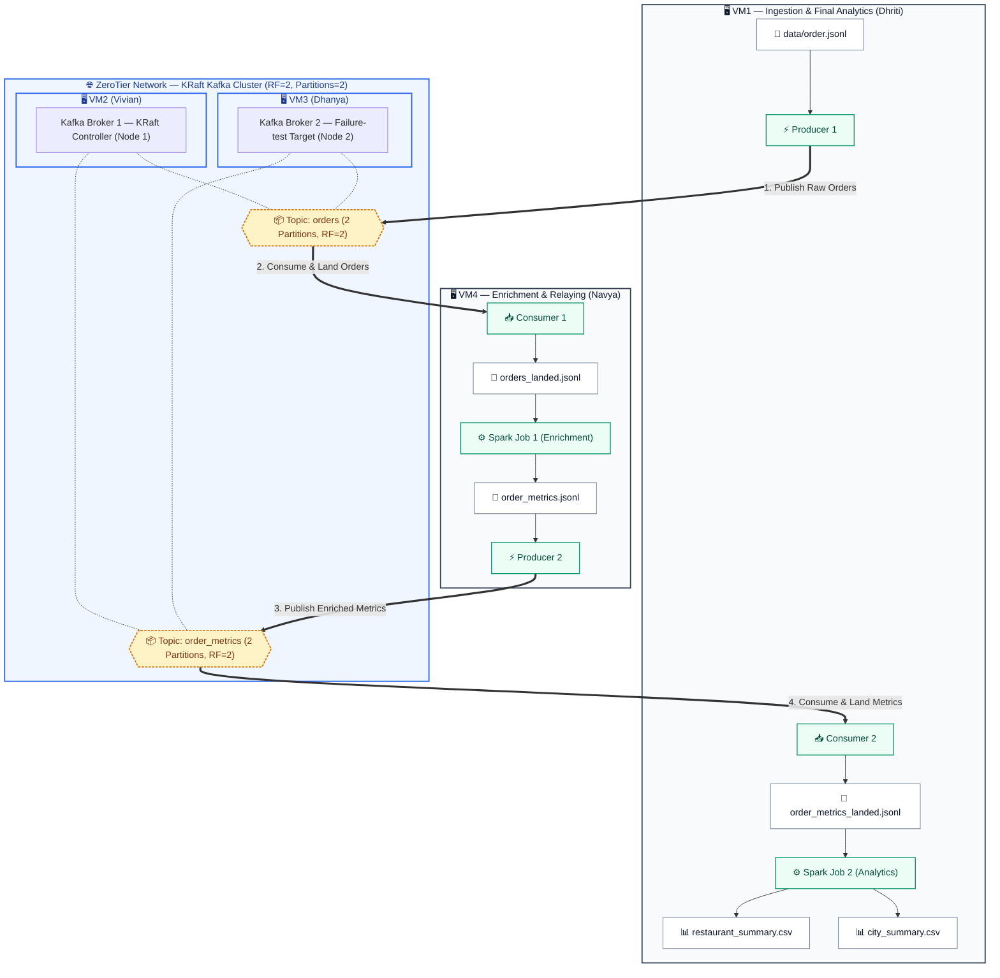
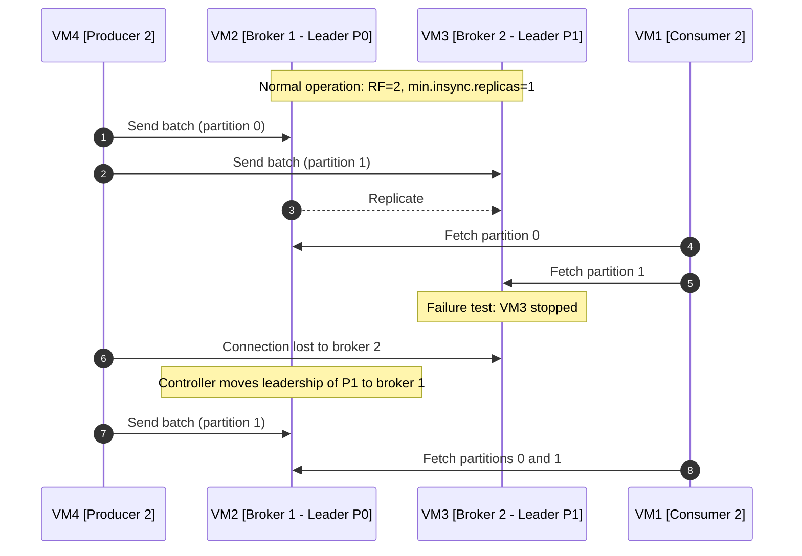

# 🍽️ Distributed Food Ordering & Analytics Pipeline

[](https://big-data-2026-supersite.super.site/distributed-food-ordering-system)
[](https://www.python.org/)
[](https://spark.apache.org/)
[-231F20?style=for-the-badge&logo=apachekafka&logoColor=white)](https://kafka.apache.org/)
[](https://www.zerotier.com/)

A four-machine pipeline for the Big Data 2026 assignment *Distributed Food Ordering System*. A two-broker **Apache Kafka** cluster in KRaft mode carries food-order records between the machines, which talk over a private **ZeroTier** network. **Apache Spark** batch jobs clean the orders, compute delivery metrics, and summarise performance by restaurant and by city.

> [!NOTE]
> **Status.** Both Spark jobs are built and tested. The Kafka producer and consumer, the broker scripts, the per-machine stage scripts and the broker-failure check are in progress, so the Kafka stages below describe the design rather than finished code.

---

## 📑 Table of Contents

- [Overview](#overview)
- [System Architecture](#system-architecture)
- [Cluster Topology & Node Roles](#cluster-topology)
- [Data Pipeline & Business Logic](#data-pipeline)
- [Analytics Output Preview](#analytics-preview)
- [Broker Failure Test](#fault-tolerance)
- [Repository Layout](#repository-layout)
- [Getting Started](#getting-started)
- [Testing](#testing-verification)
- [Design Decisions](#engineering-highlights)
- [Team Members](#team-members)

---

<a id="overview"></a>
## 🔭 Overview

Every order in the dataset carries timestamps for when it was placed, accepted, picked up, promised and delivered, plus distance, amount, fee and status. Some records are deliberately dirty: malformed JSON, missing fields, impossible timestamps, zero or negative amounts, non-delivered statuses and exact duplicates. The pipeline drops those, then works out how long each order took and how late it was.

The assignment fixes a few rules that shape the design:

- Spark never reads Kafka directly. A consumer first writes each topic to a local JSONL file, and Spark reads that file.
- Both topics, `orders` and `order_metrics`, have 2 partitions and replication factor 2 on the same two-broker cluster.
- There is no HDFS, and no file is copied from VM4 to VM1. The metrics reach VM1 only through Kafka.
- The failure test stops broker 2 on VM3. VM2 keeps running, because controller handover is out of scope.

A separate reference implementation in plain Python (`verify/reference.py`) recomputes the Job 1 metrics without Spark, so the team has a second calculation to check Spark against.

---

<a id="system-architecture"></a>
## 🏗️ System Architecture



---

<a id="cluster-topology"></a>
## 👥 Cluster Topology & Node Roles

| Node | Teammate | Services | Role in the failure test |
| :--- | :--- | :--- | :--- |
| **VM1** | Dhriti ([@DHRITIRAJESH](https://github.com/DHRITIRAJESH)) | Producer 1 publishes `data/order.jsonl` to `orders`.<br>Consumer 2 lands `order_metrics` into `order_metrics_landed.jsonl`.<br>Spark Job 2 writes the two summary CSVs. | Client; keeps consuming through the surviving broker. |
| **VM2** | Vivian ([@VivianSobers](https://github.com/VivianSobers)) | KRaft controller and Kafka broker 1 (`node.id=1`, port `9092`, controller port `9093`). | Must stay up for the whole demo. |
| **VM3** | Dhanya ([@DhanyaSPrasad](https://github.com/DhanyaSPrasad)) | Kafka broker 2 (`node.id=2`, port `9092`). | The broker that gets stopped. |
| **VM4** | Navya ([@nav-yeah](https://github.com/nav-yeah)) | Consumer 1 lands `orders` into `orders_landed.jsonl`.<br>Spark Job 1 writes `order_metrics.jsonl`.<br>Producer 2 publishes that file to `order_metrics`. | Client. |

> [!NOTE]
> A spare standby machine on the same ZeroTier network is set up to take over VM1, VM3 or VM4 if a laptop fails. It cannot replace VM2 once the demo has started, since that would need a new controller.

---

<a id="data-pipeline"></a>
## 🔄 Data Pipeline & Business Logic

### Stage 1: Ingestion

1. Producer 1 on VM1 sends each line of `data/order.jsonl` to the `orders` topic as raw bytes, without parsing it, so malformed records reach Spark and get dropped there.
2. Consumer 1 on VM4 reads `orders` and writes every message to `orders_landed.jsonl`. It stops once the topic has been quiet for a set time.

### Stage 2: Spark Job 1, cleaning and enrichment

Spark Job 1 reads `orders_landed.jsonl`.

#### 🧹 Cleaning rules

- Malformed JSON lines are dropped.
- All 14 fields are required. A missing field, `null`, an empty string or a whitespace-only string makes the record invalid. Extra fields are ignored.
- `distance_km`, `order_amount` and `delivery_fee` must be JSON numbers. A quoted number such as `"5.6"` is invalid.
- All five timestamps must parse as `yyyy-MM-dd HH:mm:ss` and must be in order:
  $$\text{order\_timestamp} \le \text{accepted\_timestamp} \le \text{picked\_up\_timestamp} < \text{delivered\_timestamp}$$
  Delivery has to come strictly after pickup, or the speed would divide by zero.
- `distance_km > 0` and `order_amount > 0`.
- Only `status == "DELIVERED"` (exact, case-sensitive) is kept.
- Exact duplicates, meaning identical values in all 14 fields regardless of key order or extra fields, are counted once. Two records with the same `order_id` but any differing field are both kept, because the brief only removes *exact* duplicates.

Spark runs with `spark.sql.ansi.enabled=false` and `spark.sql.legacy.timeParserPolicy=CORRECTED`, so a bad timestamp becomes null and the record is dropped instead of crashing the job. Durations are computed in UTC, so the machines' time zones don't change the results.

#### 📐 Derived metrics

| Metric column | Definition | Meaning |
| :--- | :--- | :--- |
| `preparation_time_min` | $\text{picked\_up} - \text{accepted}$ | Kitchen time, in minutes. |
| `delivery_time_min` | $\text{delivered} - \text{picked\_up}$ | Time on the road, in minutes. |
| `fulfillment_time_min` | $\text{delivered} - \text{order}$ | Order placed to order delivered, in minutes. |
| `delivery_speed_kmph` | $\frac{\text{distance\_km}}{\text{delivery\_time\_min} / 60}$ | Average delivery speed in km/h. |
| `delay_min` | $\max(0, \text{delivered} - \text{expected\_delivery})$ | Minutes past the promised time, floored at 0. |
| `delivery_status` | `ON_TIME` if the delay is 0, else `DELAYED` | |
| `delay_category` | see below | |

$$\text{delay\_category} = \begin{cases}
\text{ON\_TIME} & \text{delay\_min} = 0 \\
\text{SLIGHT\_DELAY} & 0 < \text{delay\_min} \le 15 \\
\text{MODERATE\_DELAY} & 15 < \text{delay\_min} \le 30 \\
\text{SEVERE\_DELAY} & \text{delay\_min} > 30
\end{cases}$$

Status and category use the unrounded delay, and speed uses the unrounded delivery time. The computed numbers are then rounded half-up to 2 decimal places. Job 1 writes a single file, `order_metrics.jsonl`: one JSON object per line holding the 14 input fields plus the 7 computed ones, sorted so a rerun produces the same file.

### Stage 3: Relaying the metrics

1. Producer 2 on VM4 publishes `order_metrics.jsonl` to the `order_metrics` topic.
2. Consumer 2 on VM1 writes that topic to `order_metrics_landed.jsonl`.

### Stage 4: Spark Job 2, analytics

Spark Job 2 reads `order_metrics_landed.jsonl`, drops malformed lines and exact duplicates, and writes two CSVs:

1. `restaurant_summary.csv`: `restaurant_id`, `order_count`, `avg_order_amount`, `avg_preparation_time_min`, `avg_delivery_time_min`, `delayed_order_count`, `delay_rate_pct`
2. `city_summary.csv`: `city`, `order_count`, `avg_order_amount`, `avg_delivery_time_min`, `delayed_order_count`, `delay_rate_pct`

$$\text{delay\_rate\_pct} = \text{round}\left(\frac{\text{delayed\_order\_count}}{\text{order\_count}} \times 100, 2\right)$$

All averages and rates are rounded to 2 decimal places.

---

<a id="analytics-preview"></a>
## 📊 Analytics Output Preview

These are the actual outputs from running Job 1 and then Job 2 directly on `data/order.jsonl`, on one machine without Kafka. Of the 62 input lines, 44 orders survive cleaning. The CSVs store plain numbers; the `%` signs are added here for readability.

### 🏙️ City summary (`city_summary.csv`)

| city | order_count | avg_order_amount | avg_delivery_time_min | delayed_order_count | delay_rate_pct |
| :--- | :---: | :---: | :---: | :---: | :---: |
| **Bengaluru** | 16 | 634.38 | 22.50 | 12 | 75.00% |
| **Hyderabad** | 7 | 590.14 | 45.00 | 7 | 100.00% |
| **Mumbai** | 14 | 590.50 | 32.50 | 11 | 78.57% |
| **Pune** | 7 | 614.57 | 40.00 | 3 | 42.86% |

### 🍳 Restaurant summary (`restaurant_summary.csv`)

| restaurant_id | order_count | avg_order_amount | avg_preparation_time_min | avg_delivery_time_min | delayed_order_count | delay_rate_pct |
| :---: | :---: | :---: | :---: | :---: | :---: | :---: |
| **R01** | 8 | 639.00 | 12.50 | 20.00 | 4 | 50.00% |
| **R02** | 8 | 629.75 | 12.75 | 25.00 | 8 | 100.00% |
| **R03** | 7 | 542.00 | 13.43 | 30.00 | 4 | 57.14% |
| **R04** | 7 | 639.00 | 13.29 | 35.00 | 7 | 100.00% |
| **R05** | 7 | 614.57 | 13.14 | 40.00 | 3 | 42.86% |
| **R06** | 7 | 590.14 | 13.00 | 45.00 | 7 | 100.00% |

---

<a id="fault-tolerance"></a>
## ⚡ Broker Failure Test

With replication factor 2, every partition has a copy on both brokers. When VM3 stops, the controller on VM2 moves leadership of VM3's partitions to broker 1, and clients carry on through VM2. The test has not been run yet; this is the behaviour it is meant to show.



> [!IMPORTANT]
> - Topics are created with `--partitions 2 --replication-factor 2`.
> - The brokers set `offsets.topic.replication.factor=2`, so consumer offsets also survive losing VM3, and `min.insync.replicas=1`, so writes still succeed with one broker left.
> - The KRaft controller runs on VM2 and stays up throughout the test.

---

<a id="repository-layout"></a>
## 📁 Repository Layout

```text
.                                      # Repository root
├── .gitignore                         # Generated and local file exclusions
├── README.md                          # Project documentation
├── data/                              # Input data
│   └── order.jsonl                    # Assigned order dataset
├── foodpipe/                          # Spark pipeline package
│   ├── __init__.py                    # Package marker
│   ├── io_utils.py                    # Single named JSONL and CSV file writer
│   ├── job1_enrichment.py             # Order cleaning and enrichment job
│   ├── job2_analytics.py              # Restaurant and city analytics job
│   ├── schema.py                      # Field orders and Spark schemas
│   └── spark_session.py               # Spark session configuration
├── pytest.ini                         # Test discovery and import configuration
├── requirements.txt                   # Python dependency constraints
├── tests/                             # Automated tests
│   ├── __init__.py                    # Test package marker
│   ├── conftest.py                    # Shared Spark session fixture
│   ├── test_io_utils.py               # Single-file output tests
│   ├── test_job1_cleaning.py          # Order validation and deduplication tests
│   ├── test_job1_metrics.py           # Enrichment and Job 1 CLI tests
│   ├── test_job2_analytics.py         # Summaries and Job 2 CLI tests
│   ├── test_reference.py              # Independent reference calculation tests
│   ├── test_schema.py                 # Schema and column order tests
│   └── test_spark_session.py          # Spark session settings tests
└── verify/                            # Independent reference calculations
    ├── __init__.py                    # Reference package marker
    └── reference.py                   # Reference order metrics builder
```

`output/` holds generated pipeline files and is ignored by Git.

---

<a id="getting-started"></a>
## 🚀 Getting Started

### Prerequisites

- Python 3.10
- Java 11. If your default `java` is a different version, point `JAVA_HOME` at a Java 11 install before running anything.
- Kafka 3.9.2 (`kafka_2.12-3.9.2`) on the two broker machines only. PySpark 3.3.4 comes from `requirements.txt`, so you don't need a separate Spark install.

### Set up the environment

```bash
git clone https://github.com/VivianSobers/distributed-food-ordering.git
cd distributed-food-ordering

python3.10 -m venv .venv
.venv/bin/pip install -r requirements.txt

# only if `java -version` is not 11
export JAVA_HOME=/path/to/jdk-11
```

### Run the Spark jobs

In the pipeline, Job 1 runs on VM4 against the landed `orders` file and Job 2 runs on VM1 against the landed `order_metrics` file:

```bash
.venv/bin/python -m foodpipe.job1_enrichment \
    --input output/orders_landed.jsonl \
    --output output/order_metrics.jsonl

.venv/bin/python -m foodpipe.job2_analytics \
    --input output/order_metrics_landed.jsonl \
    --restaurant-out output/restaurant_summary.csv \
    --city-out output/city_summary.csv
```

To try both jobs on one machine without Kafka, give Job 1 the raw dataset (`--input data/order.jsonl`) and give Job 2 Job 1's output (`--input output/order_metrics.jsonl`). That is how the preview tables above were produced. Each job writes exactly one named file, not a Spark folder of `part-*` files.

---

<a id="testing-verification"></a>
## 🧪 Testing

```bash
.venv/bin/python -m pytest -q
```

The tests cover every cleaning rule, including each required field, bad and misordered timestamps, quoted numbers and duplicate handling. They also check each metric formula against hand-worked values, including the delay-category boundaries at 15 and 30 minutes, the summary calculations, and the single-file output. `tests/test_reference.py` tests the plain-Python reference implementation in `verify/reference.py`. A test that compares Spark's output with the reference on the real dataset is in progress.

---

<a id="engineering-highlights"></a>
## 💡 Design Decisions

> [!TIP]
> 1. **KRaft instead of ZooKeeper.** Kafka stores its cluster metadata in its own Raft log, so there's no separate ZooKeeper ensemble to run. One controller on VM2 is enough for this assignment.
>
> 2. **Landing files between Kafka and Spark.** The brief requires it, and it also gives each Spark run a fixed input file that can be inspected and rerun.
>
> 3. **Single-file writer (`write_single_file`).** Spark normally writes a folder of `part-*` files plus `_SUCCESS`. `foodpipe/io_utils.py` writes through one partition, moves the single part file to the exact name the brief asks for, and removes the temporary folder. An empty result still produces a file (a header-only CSV).
>
> 4. **Fixed time zone and parser policy.** UTC sessions and `timeParserPolicy=CORRECTED` mean every teammate's machine parses the same timestamps the same way.

---

<a id="team-members"></a>
## 👥 Team Members

<div align="center">

| Member | GitHub | Role | Node |
| :--- | :---: | :--- | :---: |
| **Vivian** | [@VivianSobers](https://github.com/VivianSobers) | KRaft controller & Kafka broker 1 | **VM2** |
| **Dhriti** | [@DHRITIRAJESH](https://github.com/DHRITIRAJESH) | Producer 1, Consumer 2 & Spark Job 2 | **VM1** |
| **Dhanya** | [@DhanyaSPrasad](https://github.com/DhanyaSPrasad) | Kafka broker 2 & failure test | **VM3** |
| **Navya** | [@nav-yeah](https://github.com/nav-yeah) | Consumer 1, Spark Job 1 & Producer 2 | **VM4** |

</div>

<div align="center">
<sub>Big Data 2026 (UE24CS343AB2)</sub>
</div>
