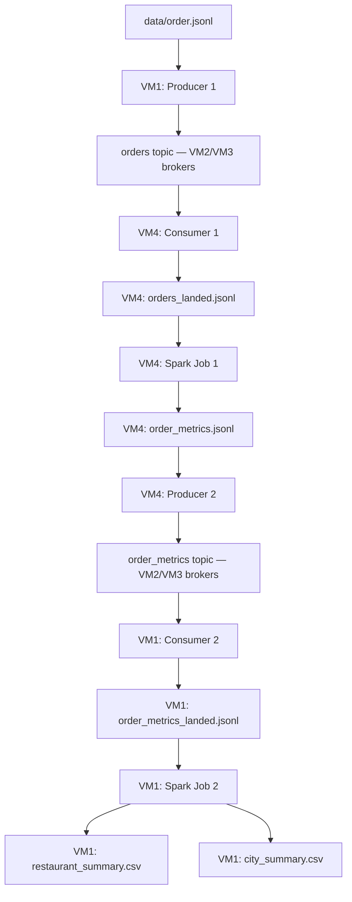

# Distributed Food Ordering System

This repository contains the Distributed Food Ordering System assignment for Big Data 2026 (UE24CS343AB2). The design uses Kafka to move food-order records between four machines and Spark batch jobs to process local files written by consumers. Spark Job 1 cleans delivered orders and calculates timing, speed and delay metrics; Spark Job 2 aggregates those metrics into restaurant and city summaries. Both Spark jobs are implemented; the architecture below shows the intended distributed data flow.

## Architecture

The machines communicate over a private ZeroTier network. Both Kafka topics, `orders` and `order_metrics`, share the same two-broker cluster on VM2 and VM3. Each topic has two partitions and replication factor two. Consumers land records in local JSONL files before Spark runs. Spark does not read Kafka directly, and the pipeline uses no HDFS or direct file transfer from VM4 to VM1.

| Machine | Team member | Assigned roles |
| --- | --- | --- |
| VM1 | Dhriti ([@DHRITIRAJESH](https://github.com/DHRITIRAJESH)) | Producer 1 publishes `data/order.jsonl` to `orders`; Consumer 2 lands `order_metrics` into `order_metrics_landed.jsonl`; Spark Job 2 writes the two summary CSVs. |
| VM2 | Vivian ([@VivianSobers](https://github.com/VivianSobers)) | KRaft controller and Kafka broker 1. |
| VM3 | Dhanya ([@DhanyaSPrasad](https://github.com/DhanyaSPrasad)) | Kafka broker 2; the broker stopped during the broker-failure test. |
| VM4 | Navya ([@nav-yeah](https://github.com/nav-yeah)) | Consumer 1 lands `orders` into `orders_landed.jsonl`; Spark Job 1 writes `order_metrics.jsonl`; Producer 2 publishes that file to `order_metrics`. |

The broker-failure test stops VM3 while VM2 remains running; controller handover is out of scope. A spare standby machine can take over any role except VM2 during the demo.

## Data flow

### Stage 1: Order enrichment

1. Producer 1 on VM1 reads `data/order.jsonl` and publishes its records to the `orders` topic.
2. Consumer 1 on VM4 reads `orders` and writes the local file `orders_landed.jsonl`.
3. Spark Job 1 on VM4 reads `orders_landed.jsonl`, cleans and deduplicates orders, and writes enriched records to `order_metrics.jsonl`.

### Stage 2: Operations analytics

1. Producer 2 on VM4 reads `order_metrics.jsonl` and publishes its records to the `order_metrics` topic.
2. Consumer 2 on VM1 reads `order_metrics` and writes the local file `order_metrics_landed.jsonl`.
3. Spark Job 2 on VM1 reads `order_metrics_landed.jsonl` and writes `restaurant_summary.csv` and `city_summary.csv` with order counts, averages and delay rates.

Assignment constraints: both topics have 2 partitions and replication factor 2 on the same VM2/VM3 cluster. Spark reads only local files written by consumers. There is no HDFS or direct VM4-to-VM1 file transfer; metrics travel through Kafka. VM3 is the failure-test broker; VM2 remains running.

## Cleaning rules

Spark Job 1 applies these rules before enrichment:

- **Malformed JSON:** read with the explicit order schema in permissive mode, then drop records marked as corrupt.
- **Required fields:** all 14 input fields are required. Missing or null values are invalid, as are empty or whitespace-only strings. Extra fields are ignored.
- **Numeric types:** `distance_km`, `order_amount` and `delivery_fee` must be JSON numbers; quoted numbers such as `"5.6"` are invalid.
- **Timestamps:** all five timestamp fields must parse with `yyyy-MM-dd HH:mm:ss`. Spark uses `spark.sql.ansi.enabled=false` and `spark.sql.legacy.timeParserPolicy=CORRECTED`, so bad timestamp values become null instead of crashing the job; those records are dropped. Parsing and duration calculations use UTC.
- **Event order:** require `order_timestamp <= accepted_timestamp <= picked_up_timestamp < delivered_timestamp`. Equal order, acceptance and pickup times are allowed; delivery must occur after pickup so delivery speed is defined. The expected delivery time must parse but need not follow this sequence.
- **Positive values:** require `distance_km > 0` and `order_amount > 0`. There is no positivity restriction on `delivery_fee`.
- **Status:** accept only the exact, case-sensitive value `DELIVERED`.
- **Duplicates:** count records once when all 14 input field values match, regardless of JSON key order, formatting or extra fields. Keep two records with the same `order_id` when any input field differs: the team defines duplicates by the complete record, so an ID alone is insufficient to discard distinct content.

## Metrics and outputs

### Job 1: Order metrics

Timestamp differences in the table are measured in minutes. Let `d` be the unrounded delay, floored at zero.

| Metric | Formula or rule |
| --- | --- |
| `preparation_time_min` | `picked_up_timestamp - accepted_timestamp` |
| `delivery_time_min` | `delivered_timestamp - picked_up_timestamp` |
| `fulfillment_time_min` | `delivered_timestamp - order_timestamp` |
| `delivery_speed_kmph` | `distance_km / (unrounded delivery_time_min / 60)` |
| `delay_min` | `max(0, delivered_timestamp - expected_delivery_timestamp)` |
| `delivery_status` | `ON_TIME` when `d = 0`; otherwise `DELAYED`. |
| `delay_category` | `ON_TIME` when `d = 0`; `SLIGHT_DELAY` when `0 < d <= 15`; `MODERATE_DELAY` when `15 < d <= 30`; `SEVERE_DELAY` when `d > 30`. |

Computed numeric metrics use half-up rounding to two decimal places. Speed uses the unrounded delivery duration; delivery status and delay category use the unrounded delay.

`order_metrics.jsonl` contains one JSON object per line: the 14 input fields in schema order, followed by the seven metrics in the table's order. Original timestamp strings are preserved. Records are sorted ascending by all 14 input fields in schema order, starting with `order_id`, so differing records with the same ID also have a deterministic order.

### Job 2: Summary CSVs

Job 2 reads `order_metrics_landed.jsonl`, drops malformed records and exact duplicates across all 21 fields, and writes two CSVs with headers. Their columns, in order, are:

- **`restaurant_summary.csv`**, sorted by `restaurant_id`: `restaurant_id, order_count, avg_order_amount, avg_preparation_time_min, avg_delivery_time_min, delayed_order_count, delay_rate_pct`.
- **`city_summary.csv`**, sorted by `city`: `city, order_count, avg_order_amount, avg_delivery_time_min, delayed_order_count, delay_rate_pct`.

Within each restaurant or city, `delayed_order_count` counts records whose `delivery_status` is `DELAYED`, and `delay_rate_pct = delayed_order_count / order_count * 100`. Averages and delay rates use half-up rounding to two decimal places; counts are integers.

Each Spark output is one named file, rather than a directory of Spark part files.
