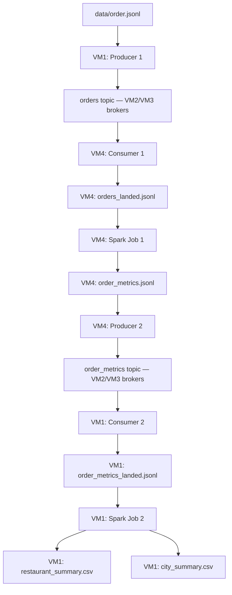

# Distributed Food Ordering System

This repository contains the Distributed Food Ordering System assignment for Big Data 2026 (UE24CS343AB2). The design uses Kafka to move food-order records between four machines and Spark batch jobs to process local files written by consumers. Spark Job 1 cleans delivered orders and calculates timing, speed and delay metrics; Spark Job 2 aggregates those metrics into restaurant and city summaries. Both Spark jobs are implemented; the architecture below shows the intended distributed data flow.

## Architecture

The machines communicate over a private ZeroTier network. Both Kafka topics, `orders` and `order_metrics`, share the same two-broker cluster on VM2 and VM3. Each topic has two partitions and replication factor two. Consumers land records in local JSONL files before Spark runs. Spark does not read Kafka directly, and the pipeline uses no HDFS or direct file transfer from VM4 to VM1.

| Machine | Team member | Assigned roles |
| --- | --- | --- |
| VM1 | Dhriti ([@DHRITIRAJESH](https://github.com/DHRITIRAJESH)) | Producer 1 publishes `data/order.jsonl` to `orders`; Consumer 2 lands `order_metrics` into `order_metrics_landed.jsonl`; Spark Job 2 writes the two summary CSVs. |
| VM2 | Vivian ([@VivianSobers](https://github.com/VivianSobers)) | KRaft controller and Kafka broker 1. |
| VM3 | Dhanya ([@DhanyaSPrasad](https://github.com/DhanyaSPrasad)) | Kafka broker 2; the broker stopped during the broker-failure test. |
| VM4 | Navya ([@nav-yeah](https://github.com/nav-yeah)) | Consumer 1 lands `orders` into `orders_landed.jsonl`; Spark Job 1 writes `order_metrics.jsonl`; Producer 2 publishes that file to `order_metrics`. |

The broker-failure test stops VM3 while VM2 remains running; controller handover is out of scope. A spare standby machine can take over any role except VM2 during the demo.
